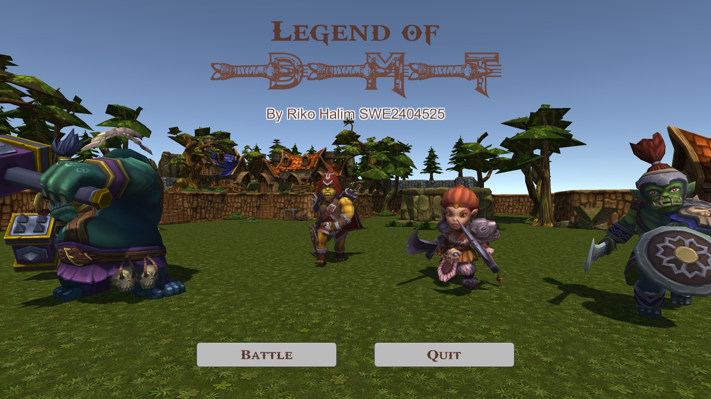
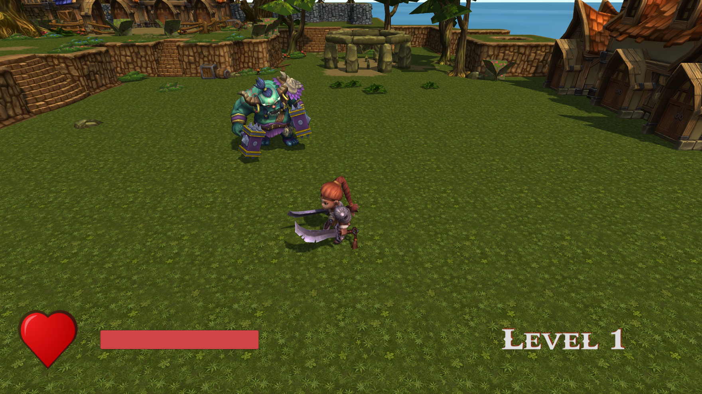

# Legend of DMT

A 3D top-down arena hack-and-slash game built with Unity and C#. Fight off waves of orc enemies, collect power-ups, and survive through 20 levels.

Created as a coursework project for the Digital Media Technology course at Xiamen University Malaysia (XMUM).

---

## Screenshots

| Main Menu / Lobby | Arena Gameplay |
|---|---|
|  |  |

---

## Gameplay

You control a barbarian hero trapped in an arena. Enemies spawn in waves, and the number of enemies increases with each level. Defeat all enemies in a level to advance. Complete Level 20 to win the game.

### Controls

| Action | Input |
|---|---|
| Move | W / A / S / D (or Arrow Keys) |
| Aim | Mouse cursor |
| Double Chop Attack | Left Mouse Button |
| Spin Attack (AoE) | Right Mouse Button |

---

## Features

### Enemy Types
- **Orc Soldier**: Basic melee fighter that runs directly toward you.
- **Orc Ranger**: Ranged enemy that stops at distance to fire arrows.
- **Orc Tanker**: Heavy enemy with higher health pool.

### Power-ups
Power-ups spawn around the arena roughly every 60 seconds:
- **Health Potion**: Restores +30 HP (up to max 100 HP).
- **Speed Boost**: Temporarily increases movement speed and leaves a fire trail effect.

### Wave System
- Each level spawns a number of enemies equal to the current level number.
- Clearing all enemies in a wave gives a brief pause before the next level begins.
- Clearing Level 20 triggers the victory screen.
- If your HP drops to 0, the game ends in defeat and returns to the main menu.

---

## Getting Started

### Prerequisites
- **Unity**: Built with Unity 5.4.2f2. Compatible with Unity 5.4+ or later Unity versions (migrating to newer versions may trigger standard API updates).

### How to Run
1. Clone or download this repository.
2. Open **Unity Hub** and click **Add**.
3. Select this project's root folder (`Legend+of+DMT`).
4. In Unity, open the project.
5. In the `Project` panel, navigate to `Assets/Scenes/`.
6. Open **`GameMenu.unity`** for the title screen, or **`Level.unity`** to jump straight into combat.
7. Click the **Play** button at the top of the Unity editor.

---

## Project Structure

```text
Assets/
├── Animator/        # Animation controllers and overrides for player & enemies
├── Audio/           # Background music and combat sound effects
├── Fonts/           # Custom UI fonts
├── Models/          # 3D models for characters, environment, weapons
├── Prefabs/         # Prefabs for enemies, arrows, power-ups, and particles
├── Scenes/          # GameMenu and Level scenes
├── Scripts/         # C# gameplay scripts (GameManager, PlayerController, AI, etc.)
└── Textures/        # Character skins and environment textures
```

---

## Author

- **Riko Halim** (SWE2404525)
- Digital Media Technology Course, XMUM
